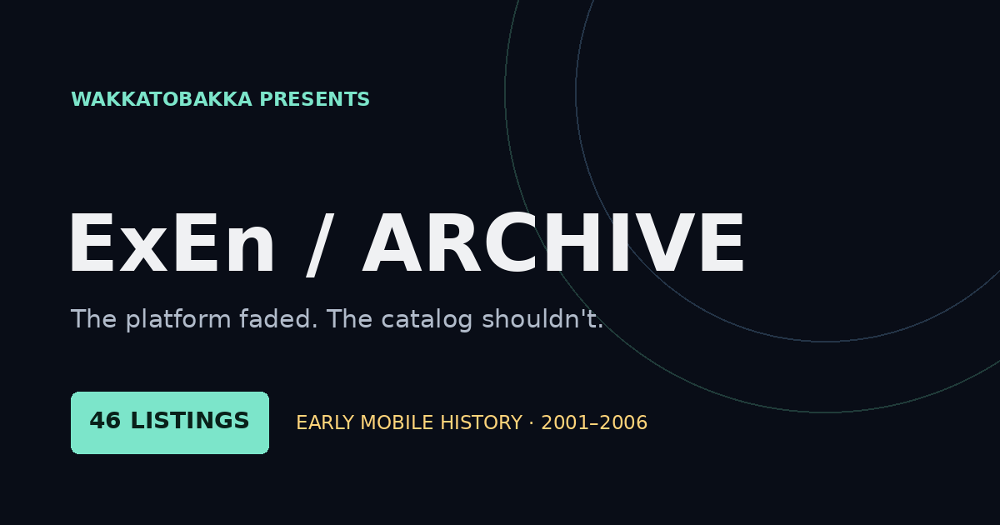

# ExEn / The Lost Catalog

**The platform faded. The catalog shouldn't.**

[**Browse the ExEn archive →**](https://wakkatobakka.github.io/exen-game-archive/) · [Sources and methods](https://wakkatobakka.github.io/exen-game-archive/about/) · [Original listings](https://www.myabandonware.com/browse/platform/exen/)

Created and maintained by **Wakkatobakka**. A searchable guide to 46 documented ExEn listings, with individual title pages and a source trail for every record.

## Explore the catalog

- **46 source-linked game records**, with listed release years from 2001–2006.
- Search by title, developer, publisher, year, or genre.
- Filter by year and genre, or sort alphabetically and chronologically.
- Featured titles, platform history, and research notes.
- [Catalog CSV](data/catalog.csv) and [complete JSON](data/catalog.json).

## What the records establish

The starting point is **My Abandonware's ExEn directory**. The records document source-listed titles; original game packages have not been inspected or tested for this index. Publisher, developer, and genre details appear where recorded in the underlying research. Unknown details remain open.

The listed years refer to the ExEn directory entries. Multi-platform source pages can describe other editions with different dates. This catalog does not claim to cover every historical ExEn release, establish package completeness, or verify present-day playability.

## Sources and credits

Original listing source: [My Abandonware — ExEn](https://www.myabandonware.com/browse/platform/exen/), reviewed for the underlying research on October 29, 2026. Every record links to its original game page. The [source register](data/SOURCES.md) and [field definitions](data/SCHEMA.md) explain the evidence and its limits.

This repository contains the catalog, original site code, and presentation. Game files, source-site prose, and original game artwork are not bundled. Third-party games, trademarks, and source materials retain their respective ownership.

## Errors and broken links

Report an incorrect detail, missing credit, or broken link through [GitHub Issues](https://github.com/Wakkatobakka/exen-game-archive/issues). Include the title or record ID and a supporting source where possible. Wakka reviews reports and publishes any updates.

## More from Wakka's archive

[Qualcomm BREW](https://wakkatobakka.github.io/qualcomm-brew-archive/) · [Zeebo](https://wakkatobakka.github.io/zeebo-archive/) · [ExEn](https://wakkatobakka.github.io/exen-game-archive/) · [DoJa](https://wakkatobakka.github.io/doja-archive/)

---
Independent catalog by Wakkatobakka. No affiliation with In-Fusio, My Abandonware, or original rights holders.
